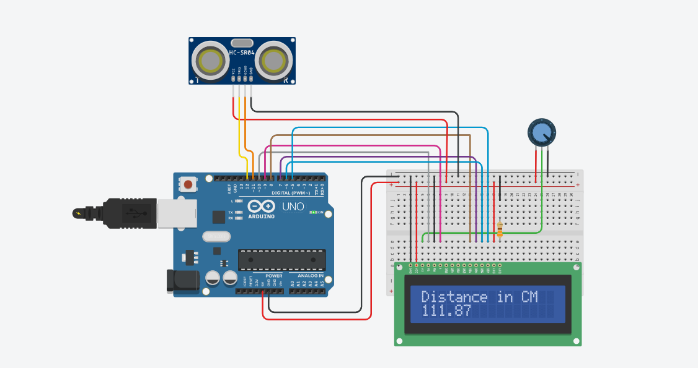

# sonicrange-lcd
# How It Works

## 1. Ultrasonic Wave Transmission
* The Arduino Uno commands the HC-SR04 sensor to emit a high-frequency sound wave through the air[cite: 1, 6].
* This acoustic burst travels outward from the module until it collides with an obstacle in its path.

## 2. Echo Detection
* Upon hitting an object, the sound wave reflects off the surface and travels back toward the sensor as an echo.
* The sensor captures the returning echo and signals the microcontroller that the sound wave has completed its round trip.

## 3. Distance Calculation
* The microcontroller measures the exact travel time elapsed between transmitting the sound wave and receiving the echo[cite: 1].
* Using the known speed of sound, the system converts this duration into a precise measurement in centimeters[cite: 1].

## 4. Dual Data Output
* The calculated distance is transmitted to the computer's Serial Monitor for real-time telemetry and debugging[cite: 1].
* Simultaneously, the data is rendered and refreshed continuously on the physical 16x2 LCD screen for standalone visibility[cite: 2].
